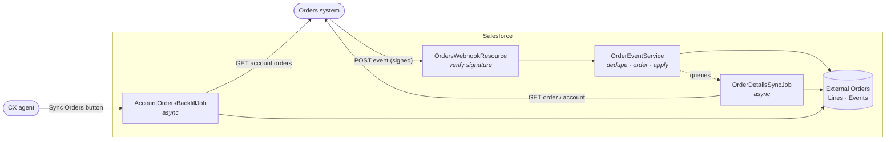

# Order Status: Salesforce Integration

Keeps Salesforce in sync with the external **Orders** system, so a CX agent can open an Account and see its orders, their current status, their lines, and every status event received.



**In short:** events update the status immediately; amount, participant and lines are fetched in the background; a **Sync Orders** button pulls orders that never sent an event.

Detailed design and tradeoffs: [`docs/DESIGN.md`](docs/DESIGN.md)

---

## Contents
1. [Setup](#setup)
2. [Simulate events](#simulate-events)
3. [What you'll see](#what-youll-see)
4. [Key decisions](#key-decisions)
5. [Questions I would have asked](#questions-i-would-have-asked)
6. [What I left out](#what-i-left-out)

---

## Setup

**Prerequisites:** a free Salesforce Developer Edition org and the Salesforce CLI (`sf`). The curl simulation also needs `openssl` and `python3`.

```bash
# 1. Get the code and log in
git clone https://github.com/MarcosAugustoFl/salesforce-order-assignment.git
cd salesforce-order-assignment
sf org login web --alias order-assignment

# 2. Deploy
sf project deploy start --source-dir force-app --target-org order-assignment

# 3. Give yourself access
sf org assign permset --name Orders_Integration --name Orders_Agent --target-org order-assignment

# 4. (Optional) run the tests: 32 tests, ~92% coverage
sf apex run test --test-level RunLocalTests --result-format human --code-coverage --target-org order-assignment
```

### Post-deploy configuration

| Item | Status | Action |
|---|---|---|
| Shared secret | Deployed | None. Stored in protected Custom Metadata `Orders_Integration_Setting__mdt.Default` with the exercise fixture `orders-takehome-2026`. |
| Named Credential `Orders_API` | Deployed | Optional. Points at the fictional `https://orders.example.test/v1`. For a live demo, change the URL and add a `Token` parameter on the External Credential principal. |
| OAuth app for the sender | Manual | Optional. Only needed to authenticate as Orders would. See [DESIGN.md → Authentication](docs/DESIGN.md#authenticating-as-the-integration-user). |

No Remote Site Setting is needed. The deploy replaces the default **Account Layout** to add the related list, the Orders fields and the Sync Orders button.

> Older CLI versions may print `Missing message metadata.transfer:Finalizing` after a deploy. The deploy still succeeds; confirm with `sf project deploy report`.

---

## Simulate events

Both options send the spec's five sample events (including the duplicate and the out-of-order one) through the real endpoint code, signature check included.

**Option A: anonymous Apex**
```bash
sf apex run --file scripts/apex/simulate-sample-events.apex --target-org order-assignment | grep USER_DEBUG
```

**Option B: curl over HTTPS**
```bash
./scripts/curl/send-sample-events.sh order-assignment
```
This option also sends a late, older event (expect `IGNORED`) and a tampered body (expect `401`).

**Expected result**

| Event | Response |
|---|---|
| `evt_001` inProgress | `200 APPLIED` |
| `evt_002` waitingForParticipant | `200 APPLIED` |
| `evt_001` (again) | `200 DUPLICATE` |
| `evt_004` sent | `200 APPLIED` |
| `evt_003` cleared | `200 APPLIED` |

End state: `ord_77d1e9` is **sent**, `ord_52ab10` is **cleared**, and `evt_001` is stored once with a delivery count of 2. Running either script again returns `DUPLICATE` for every event.

**Send your own event** (status, occurredAt, and optionally order id and event id):
```bash
./scripts/curl/send-event.sh cleared 2026-10-13T09:00:00Z                 # newer  → APPLIED
./scripts/curl/send-event.sh inProgress 2026-10-01T09:00:00Z              # older  → IGNORED
./scripts/curl/send-event.sh sent 2026-10-12T14:03:11Z ord_77d1e9 evt_004 # repeat → DUPLICATE
BAD_SIGNATURE=1 ./scripts/curl/send-event.sh cleared 2026-10-13T09:00:00Z # forged → 401
./scripts/show-state.sh                                                   # orders and event history
```

**Reset:** `sf apex run --file scripts/apex/reset-demo-data.apex --target-org order-assignment`

---

## What you'll see

Open **Accounts → AC-260914-017-2231**:

- **External Orders** related list: status, amount, and when the status was last updated.
- **Order record**: its **Lines**, and its **Events**. Each event shows whether it was *Applied* or *Ignored (older)*, how many times it was delivered, and the raw payload.
- **Sync Orders** button: pulls all of the account's orders from Orders.

Because the Orders API in this exercise is fictional, the background detail sync retries 3 times and then records a message in *Sync Error* on the order. The status is unaffected. That is the intended behavior when Orders is unreachable.

---

## Key decisions

| Topic | Decision | Why |
|---|---|---|
| **What's stored** | Order header, lines and event history are stored in Salesforce. Nothing is read live on page load. | "Never leave Salesforce": stored data works in related lists, reports and search, and when Orders is down. Live reads would cost API calls on every page view (limit: 60/min). |
| **Data model** | Custom `External_Order__c`, with `Line` and `Event` children, master-detail to Account. | The standard `Order` object requires contracts or pricebooks and has a different status model. Master-detail means sharing follows the Account. |
| **Duplicates** | Unique `Event_Id__c`. A repeat event returns `200 DUPLICATE` and only increments its delivery count. | The database guarantees each event is processed once. |
| **Out of order** | Each order keeps `Status_As_Of__c`. A status is applied only if its timestamp is newer. Ties go to the status further along the lifecycle. | Arrival order isn't guaranteed; `occurredAt` is. Older events are still recorded in the history. |
| **Concurrency** | Order rows are locked (`FOR UPDATE`) while an event is processed. | Two events for the same order can't overwrite each other. |
| **Endpoint** | **Authenticated** Apex REST (OAuth Client Credentials) plus HMAC verification. | Two independent security layers and a least-privilege integration user. A public Site is the fallback if the sender can't do OAuth. |
| **Callouts** | Never inside the webhook. Fetched asynchronously, at most 40 per run, rescheduled on `429`. | The sender times out after 10s; an Orders outage must never cause an event to be rejected. |
| **Secrets** | Outbound token in a Named Credential. Inbound HMAC secret in protected Custom Metadata. | Apex can't read Named Credential secrets, and verification needs the raw secret. |
| **No `order.created` event** | The first event for an order creates it. **Sync Orders** backfills the rest. | Orders that existed before the subscription would otherwise never appear. |

**HTTP responses:** `200` applied, ignored or duplicate · `401` bad signature · `400` invalid event · `500` unexpected error (fully rolled back, safe to retry).

---

## Questions I would have asked

**1. Can the Orders sender authenticate with OAuth, or only sign requests with a shared secret?**
- *Assumption:* it supports OAuth Client Credentials.
- *Why:* that allows an authenticated endpoint with two security layers. If not, the same code runs behind a public Site with HMAC only.

**2. Is there really no `order.created` event, and will existing orders ever be replayed?**
- *Assumption:* no created event and no replay.
- *Why:* the event list starts at `inProgress`. So the first event creates the order, and a backfill covers the rest.

**3. How should Orders accounts be matched to existing Salesforce Accounts?**
- *Assumption:* by an `Orders Account Id` field. A placeholder Account is created if none matches.
- *Why:* the spec says accounts are created in Orders, and matching by name would be guesswork. An admin can link an existing Account by filling in the field.

**4. Are event `occurredAt` and API `updatedAt` from the same clock? Can two events share a timestamp?**
- *Assumption:* yes, the same clock, and ties are possible.
- *Why:* that's the only way to compare information from both sources. Ties are broken by lifecycle order, since "statuses never move backward".

**5. Should agents see order lines? Do lines change without an order event?**
- *Assumption:* yes, show them, and they're refreshed on every order event.
- *Why:* the same API call that returns the amount returns the lines, so they cost nothing extra.

**6. What should the endpoint return for a correctly signed but malformed event? Does a 4xx count toward suspending the subscription?**
- *Assumption:* return `400`.
- *Why:* a retry won't fix it. If 4xx responses count toward suspension, I'd return `200` and park the event for review instead.

**7. Can a status ever move backward, for example a correction?**
- *Assumption:* no, except `returned`.
- *Why:* that's what the spec says. A real correction would still apply, because the newer timestamp wins.

**8. What volume should this handle?**
- *Assumption:* tens of events per minute, hundreds of orders per account.
- *Why:* that decides whether one background job per event is enough, or whether batching is needed (see below).

**9. Can an order move to another account? Can amounts come in different currencies?**
- *Assumption:* orders never move. Currency is stored as a text code next to the amount.
- *Why:* that keeps master-detail simple and avoids requiring multi-currency in the org.

**10. How long should event history and raw payloads be kept? Is anything PII?**
- *Assumption:* keep everything, and `participantRef` is an opaque reference, not PII.
- *Why:* storage isn't a concern for this exercise. Production would add archiving.

---

## What I left out

Given the 2–4 hour budget, I prioritized correctness of the event flow over these:

- **Batching detail syncs**: each applied event queues its own fetch. Next step: flag orders and refresh them in batches.
- **Global rate limiter**: each job stays under the limit, but parallel jobs could exceed 60/min. A `429` is handled by rescheduling.
- **Monitoring**: the sender goes silent after suspending the subscription. Production needs an alert when no events have arrived for a while, plus a log object.
- **Nightly reconciliation**: automatic backfill of active accounts instead of a manual button.
- **Richer UI**: a status timeline component. Standard related lists meet the brief.
- **Secret rotation**, **subscription id validation**, and the **OAuth app as metadata** (documented as a manual step).

---

## Repository layout

**Salesforce metadata** (`force-app/main/default/`)

| Folder | What's inside |
|---|---|
| `classes/` | Apex classes and their tests |
| `objects/` | External Order, Line and Event objects; Orders fields on Account; the settings type |
| `customMetadata/` | Webhook secret (exercise fixture) |
| `namedCredentials/`, `externalCredentials/` | Connection to the Orders API |
| `permissionsets/` | `Orders_Integration` (sender), `Orders_Agent` (CX users) |
| `layouts/`, `quickActions/`, `lwc/` | Page layouts and the Sync Orders button |

**Scripts and docs**

| Path | What it does |
|---|---|
| `scripts/apex/simulate-sample-events.apex` | Sends the sample events through anonymous Apex |
| `scripts/apex/reset-demo-data.apex` | Deletes the demo data |
| `scripts/curl/send-sample-events.sh` | Sends the sample events over HTTPS |
| `scripts/curl/send-event.sh` | Sends one custom event (any status, time, order, id) |
| `scripts/show-state.sh` | Prints orders and event history from the org |
| `scripts/data/sample-events.ndjson` | The spec's sample events, one per line |
| `docs/DESIGN.md` | Detailed design, error handling, code organization |
