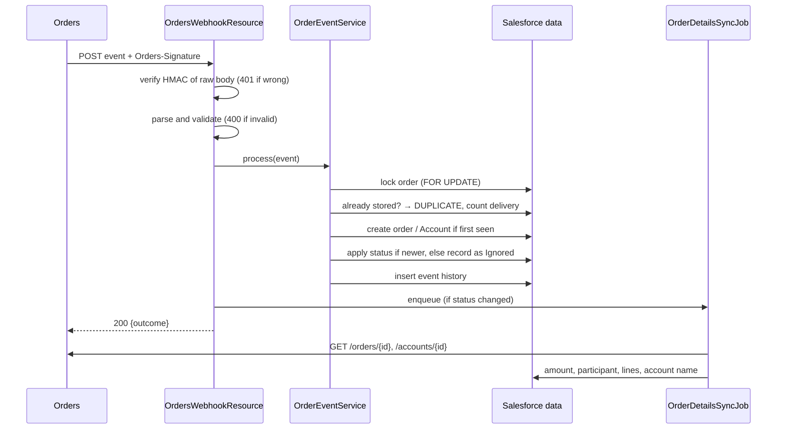

# Design notes

The README covers setup and the main decisions. This document covers the details.

- [Processing an event](#processing-an-event)
- [What is stored and why](#what-is-stored-and-why)
- [Calling the Orders API](#calling-the-orders-api)
- [Error handling](#error-handling)
- [Security](#security)
- [Code organization](#code-organization)
- [Governor limits and bulk safety](#governor-limits-and-bulk-safety)
- [Authenticating as the integration user](#authenticating-as-the-integration-user)

---

## Processing an event



### The ordering rule
`OrderStatus.supersedes()` is the single rule used by every writer (webhook, detail sync, backfill):

1. If we hold nothing yet, the new information wins.
2. Otherwise, the **later timestamp** wins (event `occurredAt` or API `updatedAt`).
3. On an exact tie, the status **further along the lifecycle** wins:
   `created → inProgress → waitingForParticipant → sent → cleared → returned`.

Because the API path uses the same rule, an API response fetched *before* a newer event arrived can never undo that event.

### Duplicates
- `External_Order_Event__c.Event_Id__c` is a **unique** external ID.
- A redelivery is found by query, returns `DUPLICATE`, and increments `Delivery_Count__c`.
- If two copies arrive at the same instant, both pass the query, but the second insert hits the unique index. That request rolls back and returns `500`, and the sender's retry is then a normal duplicate.

### Concurrency
Existing orders are selected `FOR UPDATE`, so two requests for the same order are processed one after the other. A brand-new order has no row to lock yet. Two simultaneous first events would race on the unique `Order_Id__c`; the loser returns `500` and is retried.

---

## What is stored and why

| Object | Contents | Refreshed by |
|---|---|---|
| `External_Order__c` | Status, status-as-of, amount, currency, participant, Orders dates, sync error | Events (status), detail sync, backfill |
| `External_Order_Line__c` | Line id, type, status, amount | Detail sync, on every applied event |
| `External_Order_Event__c` | Event id, type, occurred at, outcome, delivery count, raw payload | Webhook |
| `Account` (custom fields) | Orders account id, friendly id, Orders status, last synced | Detail sync, backfill |

- **Lines are stored, not read live.** They come from the same `GET /orders/{id}` call we already make for amount and participant. Reading them live would cost one callout per page view.
- **All children are master-detail.** Sharing and deletion follow the parent. The master-detail field can't be set on update, so the writer inserts new lines and updates existing ones separately.
- **Unknown Accounts get a placeholder** named after the friendly id. The detail sync replaces it with the real name.

---

## Calling the Orders API

| Situation | Behavior |
|---|---|
| Normal | Up to **40 order callouts per run**; remaining orders continue in a follow-up job 1 minute later. |
| `429 Too Many Requests` | Stop immediately and reschedule after `Retry-After` (rounded up to minutes; the platform allows 0–10). |
| `5xx` / network error | Retry, up to 3 attempts. |
| `404` / other `4xx` | Not retried. |
| Out of attempts | The message is written to `Sync_Error__c`. The status is never affected. |

- All callouts in a run happen **before any DML**, because Apex doesn't allow a callout after uncommitted work.
- The **backfill** reads one page (50 orders) per run and chains the next page. When it's finished, it hands orders without details to the detail sync. Only one follow-up job is enqueued per run, as the platform requires.

---

## Error handling

| Response | When | Effect for the sender |
|---|---|---|
| `200` | Applied, ignored (older) or duplicate | Done, no retry |
| `401` | Missing or invalid signature | Nothing stored |
| `400` | Signed but invalid (bad JSON, missing field, unknown type or version) | Message names the problem |
| `500` | Unexpected failure | Everything rolled back via savepoint; safe to retry |

The webhook makes **no callouts**, so it responds well within the sender's 10-second timeout.

---

## Security

- **Signature:** HMAC-SHA256 computed over the **raw request bytes** (never re-serialized JSON), compared in constant time.
- **Endpoint:** authenticated Apex REST. The sender uses OAuth Client Credentials for a dedicated integration user with only the `Orders_Integration` permission set.
- **Secrets:**
  - The outbound Bearer token is in the `Orders_API` Named Credential / External Credential.
  - The inbound HMAC secret is in protected Custom Metadata, because Apex can't read Named Credential secrets.
- **Sharing:**
  - Integration services are `without sharing`: a system sync must see every record to match correctly, and access is controlled by permission sets.
  - The agent-facing controller is `with sharing` and uses `WITH USER_MODE`.

---

## Code organization

| Layer | Class | Responsibility |
|---|---|---|
| HTTP in | `OrdersWebhookResource` | Maps HTTP to the service; status codes; rollback |
| Security | `OrdersSignatureVerifier`, `OrdersIntegrationConfig` | HMAC verification; where the secret lives |
| Domain | `OrderEvent`, `OrderStatus` | Parse and validate events; the ordering rule |
| Service | `OrderEventService` | Dedupe, lock, create, apply, record history |
| HTTP out | `OrdersApiClient` | Typed GET calls through the Named Credential |
| Persistence | `ExternalOrderWriter` | Writes API data with the same ordering rule |
| Async | `OrderDetailsSyncJob`, `AccountOrdersBackfillJob`, `QueueableChain` | Enrichment, backfill, retries, rate limiting |
| UI | `OrdersSyncController`, `syncOrders` LWC | Sync Orders button |
| Utility | `JsonReader` | Strict JSON reading with clear error messages |

Tests: `OrdersWebhookResourceTest`, `OrderEventServiceTest`, `OrdersSignatureVerifierTest`, `OrderDetailsSyncJobTest`, `AccountOrdersBackfillJobTest`, with shared helpers `OrdersTestData` and `OrdersApiMock`.

---

## Governor limits and bulk safety

- `OrderEventService.process()` takes a **list** and uses a fixed number of queries and DML statements regardless of size. A test processes 200 events across 100 orders in one call and asserts ≤ 4 queries and ≤ 4 DML statements.
- Callouts: ≤ 40 order callouts per run (the platform limit is 100).
- One child Queueable per job. That's why the backfill carries its list of orders forward instead of enqueuing two jobs.
- Apex tests can't chain Queueables, so `QueueableChain` captures the follow-up job during tests for assertions.

---

## Authenticating as the integration user

1. Create a dedicated integration user and assign the **`Orders_Integration`** permission set.
2. Setup → **External Client App Manager** → New. Enable OAuth with the `api` scope and the **Client Credentials Flow**. A callback URL is required but unused (`https://localhost`).
3. In the app's policies, set **Run As** to the integration user.
4. Run the simulation as the sender would:
   ```bash
   ORDERS_CLIENT_ID=... ORDERS_CLIENT_SECRET=... ./scripts/curl/send-sample-events.sh order-assignment
   ```

The app isn't deployed from source, because its consumer secret is generated per org.
